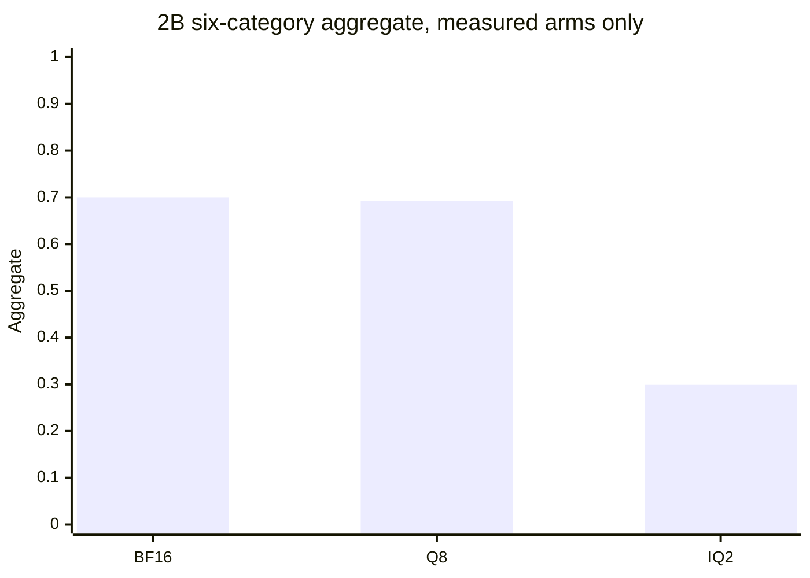

# P9 quality breakpoint

Status: **partial**. No model was started for this note. The numbers below
are counts of rows already stored under protocol `p9-2026-10-02-1`.
Empty cells were not measured. The locked pass ratios were not changed.

Study label for the 2B rows: `METHOD_COMPARISON_NOT_27B_RETENTION`.
The 27B IQ2 file is a different network. Its scores are not a ratio
against 2B BF16 and not a ratio against 27B Q4.

## What was already done

| Item | State |
|---|---|
| 27B UD-IQ2_XXS absolute suite, 395 rows | Measured. Aggregate 0.774. Reference `UNAVAILABLE` |
| 27B error table | Measured classes in [P9_ERROR_ANALYSIS.md](P9_ERROR_ANALYSIS.md). No BF16 arm |
| 2B BF16 vs UD-IQ2_XXS, same ids | Measured. Call `QUALITY_DEGRADED`. See [P9_QWEN35_2B_PAIR.md](P9_QWEN35_2B_PAIR.md) |
| 2B Q8_0, embedding on CUDA0 | Measured. Point estimate `PASS`, aggregate 0.693 vs BF16 0.700 |
| 2B Q4_K_M short suite, 350 rows | Measured. Same prompt SHA-256 as BF16 on every short id. No summary row |
| 2B Q4_K_M long context | Partial: 20/45 stored, all 20 correct. 25 needles are absent |
| Q5, Q3, IQ3 | Not run |
| LONGTASK-V1 | Not run. The spec and scorers are now in `src/exvram/longtask.py` |
| 27B Q4 | Not run. The published file is larger than this card |

Q4 weights: `Qwen3.5-2B-Q4_K_M.gguf`, 1,280,835,840 bytes, SHA-256
`aaf42c8b7c3cab2bf3d69c355048d4a0ee9973d48f16c731c0520ee914699223`,
role `qwen35_2b_q4_k_m`. Same protocol, temperature 0, seed 42, no system
prompt. Caps match the lock: reasoning 512, math 768, coding 512,
factual 16, instruction 768.

## Measured 2B scores

Six-category aggregate uses the unweighted mean. Q4 has no six-category
aggregate because 25 long-context rows are missing.

| Format | File bytes | Reasoning | Math | Coding | Factual | Instruction | Long context | Aggregate |
|---|---:|---:|---:|---:|---:|---:|---:|---:|
| BF16 GGUF | 3,775,709,216 | 29/60 | 81/100 | 13/40 | 72/100 | 43/50 | 45/45 | 0.700 |
| Q8_0 GPU | 2,012,012,800 | 30/60 | 78/100 | 14/40 | 69/100 | 42/50 | 45/45 | 0.693 |
| Q4_K_M | 1,280,835,840 | 29/60 | 71/100 | 12/40 | 67/100 | 41/50 | 20/20 stored, 25 absent | |
| IQ2_XXS | 768,270,592 | 8/60 | 6/100 | 1/40 | 42/100 | 10/50 | 43/45 | 0.299 |
| Q5_K_M | | | | | | | | |
| Q3_K_M | | | | | | | | |

Short-sample medians of `predicted_per_second` and `prompt_ms` over the
350 short rows. These are not the occupied-8192 speed protocol.

| Format | Decode tok/s | Prefill tok/s |
|---|---:|---:|
| BF16 | 88.11 | 119.22 |
| Q8_0 GPU | 141.19 | 184.28 |
| Q4_K_M | 186.74 | 252.46 |
| IQ2_XXS | 217.22 | 287.83 |

Decode is the median of `predicted_per_second` on rows with at least 8
predicted tokens. Prefill is the median of `prompt_per_second` on the
short rows. `prompt_ms` is prompt time. A separate TTFT was not stored.
Cap-hit IQ2 rows make its decode sample longer than the other arms.

Recorded llama-server weight buffers at context 8448, not a traced
nvidia-smi peak of the quality run: Q4_K_M CUDA0 1211.05 MiB with the
embedding on GPU; Q8_0 CUDA0 1908.35 MiB, one graph; IQ2 CUDA0 722.23 MiB
plus a 333.44 MiB host embedding; BF16 CUDA0 3590.35 MiB plus a 970 MiB
host embedding. Q4 cap hits on the short suite: math 7/100, coding 3/40,
instruction 2/50, reasoning 0/60, factual 0/100.

Q8 stays inside the locked aggregate ratio of 0.90 (share 0.991). Coding
on Q8 still straddles its own 0.85 ratio. IQ2 falls outside the aggregate
interval. Q4's finished categories sit near BF16. Paired Wald 95% intervals on
Q4 minus BF16: reasoning −0.092 to +0.092, math −0.176 to −0.024,
coding −0.110 to +0.060, factual −0.108 to +0.008, instruction −0.150
to +0.070. Math is the only closed cell whose interval lies entirely
below zero. The others cross zero. That is not a six-category call.

## Why 2B IQ2 scores 6/100 on GSM8K

Same prompts, same caps, same `--reasoning off`, same chat mode as BF16,
Q8, and Q4. The launch is not the difference. Classes are from
`exvram.breakpoint.math_failure_class` on the stored IQ2 math rows:

| Class | IQ2 rows |
|---|---:|
| ok | 6 |
| repetition (a line longer than 40 characters repeated at least 3 times) | 48 |
| cap hit and no `####` marker | 26 |
| cap hit and a wrong `####` marker | 10 |
| finished with a wrong marker | 10 |
| first `####` matched gold while the stored score was wrong | 0 |

94 predictions are wrong. 84 of those hit the 768 cap. 48 of the wrong
rows repeat one line, and 26 hit the cap with no `####` marker.
On BF16, Q8, and Q4, zero wrong rows had a repeated line, and zero wrong
rows had a first `####` that matched gold while the score said wrong.
The scorer is not throwing away a correct first marker on this file.
The IQ2 answers loop and stop at the cap. Raising the cap was not done.
More tokens of the same loop are not evidence the answer would appear.

27B IQ2 math on the same protocol is 89/100 absolute, with 4 finished
wrong numbers and 7 rows cut at 768. That is not the 2B loop, and it is
not a comparison with 27B BF16.

## Long tasks and context

LONGTASK-V1 is specified in [LONGTASK_V1.md](LONGTASK_V1.md) and
`src/exvram/longtask_v1.py`. It has not been executed. The checker scores
saved text and, for the ledger only, runs candidate modules under
`python -I` for at most 5 seconds. `MODEL_RUN` is `NOT_RUN`.

Stored needles, actually filled:

| Arm | 2048 | 4096 | 8192 |
|---|---:|---:|---:|
| BF16 | 15/15 | 15/15 | 15/15 |
| Q8_0 GPU | 15/15 | 15/15 | 15/15 |
| Q4_K_M | 15/15 | 5/15 | |
| IQ2 | 15/15 | 14/15 | 14/15 |

The two IQ2 misses dropped the last digit of a 6-digit code and stopped
on their own (`predicted_n` 6, cap 64). Filling a longer prompt is not,
by itself, a long task.

## 27B, without a 2B ratio

The working file remains UD-IQ2_XXS, 7,266,070,528 bytes, peak 7767 MiB
at occupied 8192. Absolute weak cells are coding 21/40 and tracking
shuffled objects 9/20. Long context is 45/45. Math does not show the 2B
repetition collapse. No 27B Q4 or BF16 arm exists, so none of those cells
are a quantization loss against a 27B reference.

A head-only lift of `output.weight` from `q3_k` to `q4_k` fits the derived
16k spare. Embeddings and the `iq1_s` body do not. That recipe is not a
measured quality gain. See [QUANT_PROVENANCE.md](QUANT_PROVENANCE.md).

## Next run, not started

Finish the 25 missing Q4 needles, then stop. Do not start Q3 or Q5 until
that arm has a six-category aggregate. The runner skips sample ids already
marked `measured`. Missing ids:

`needle:4096:5` through `needle:4096:14`, and `needle:8192:0` through
`needle:8192:14`.

Q4_K_M on this 2B file is a CUDA buffer of about 1211 MiB at context 8448.
That is inside the 8151 MiB card. It still needs a free-RAM check and an
explicit go-ahead before llama-server starts. The 27B Q4 file stays
unloaded.

## Answers

1. Ready before this note: the 27B IQ2 suite, its error table, the full
   2B BF16/IQ2 pair, and the full 2B Q8 GPU pair. Q4's short suite was
   already on disk and had not been judged.
2. Best measured quality per byte on this card's 2B ladder is Q8: aggregate
   0.693 against BF16 0.700. Q4 may land in the same band. Its protocol
   aggregate is unfinished.
3. The measured break is between Q8 and IQ2. Q4 is not the break until
   the missing needles exist.
4. 2B IQ2 math fails by repetition and by never emitting `####`, under
   the same launch as the arms that do emit it.
5. On the five finished categories, Q4 matches BF16 reasoning exactly
   and drops math from 81 to 71. The six-category distance is not measured.
6. A full long task has not been run. The needle task is not that test.
7. There is no scored long-task trace, so there is no first failing step.
8. At 2k, 4k, and 8k the BF16 and Q8 needles are 15/15. IQ2 loses one
   code digit at 4k and one at 8k. Q4 has no 8k rows.
9. 27B IQ2's weak absolute cells are coding and two reasoning tasks.
   The 2B repetition collapse is not what the 27B math rows show.
10. No measured change keeps the 27B weights and raises those cells
    inside the same 7767 MiB peak.
11. Waiting on permission: the 25 Q4 needles. After that, Q3_K_M if the
    Q4 aggregate stays inside the locked ratios, otherwise Q5_K_M.
    LONGTASK-V1 on 2B is the task battery after the quant ladder moves.
12. The single next measurement is those 25 Q4 needles.
