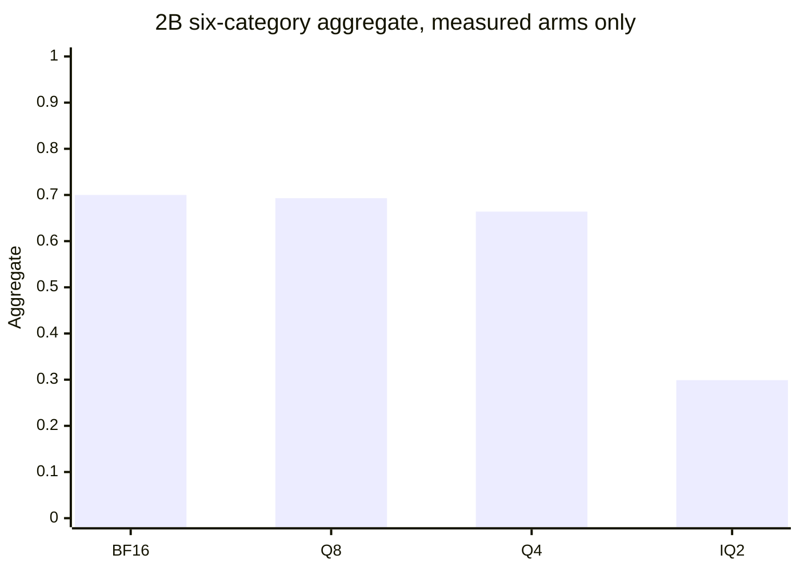

# P9 quality breakpoint

Status: **Q4 tail measured** on 2026-10-24. Protocol `p9-2026-10-02-1`
is unchanged. The point-estimate call for 2B Q4_K_M against the stored
2B BF16 arm is `PASS`. The paired-interval call is `INCONCLUSIVE`.
That is not `ZERO_LOSS` and not `QUALITY_PRESERVED_WITHIN_MARGIN`.
Empty cells were not measured.

Study label for the 2B rows: `METHOD_COMPARISON_NOT_27B_RETENTION`.
The 27B IQ2 file is a different network. Its scores are not a ratio
against 2B BF16 and not a ratio against 27B Q4.

## What was already done

| Item | State |
|---|---|
| 27B UD-IQ2_XXS absolute suite, 395 rows | Measured. Aggregate 0.774. Reference `UNAVAILABLE` |
| 27B error table | Measured classes in [P9_ERROR_ANALYSIS.md](P9_ERROR_ANALYSIS.md). No BF16 arm |
| 2B BF16 vs UD-IQ2_XXS, same ids | Measured. Call `QUALITY_DEGRADED`. See [P9_QWEN35_2B_PAIR.md](P9_QWEN35_2B_PAIR.md) |
| 2B Q8_0, embedding on CUDA0 | Measured. Point estimate `PASS`, aggregate 0.693 vs BF16 0.700 |
| 2B Q4_K_M, 395 rows | Measured. The 370 stored rows were kept. The 25 missing needles were appended on 2026-10-24, all correct. One summary row |
| Q5, Q3, IQ3 | Not run |
| LONGTASK-V1 | Not run. Spec in [LONGTASK_V1.md](LONGTASK_V1.md), scorer in `src/exvram/longtask_v1.py` |
| 27B Q4 | Not run. The published file is larger than this card |

Q4 weights: `Qwen3.5-2B-Q4_K_M.gguf`, 1,280,835,840 bytes, SHA-256
`aaf42c8b7c3cab2bf3d69c355048d4a0ee9973d48f16c731c0520ee914699223`,
role `qwen35_2b_q4_k_m`. Same protocol, temperature 0, seed 42, no system
prompt. Caps match the lock: reasoning 512, math 768, coding 512,
factual 16, instruction 768.

## Measured 2B scores

Six-category aggregate uses the unweighted mean. Q4 now has one:
0.663889, which is 0.949 of the BF16 aggregate 0.699722.

| Format | File bytes | Reasoning | Math | Coding | Factual | Instruction | Long context | Aggregate |
|---|---:|---:|---:|---:|---:|---:|---:|---:|
| BF16 GGUF | 3,775,709,216 | 29/60 | 81/100 | 13/40 | 72/100 | 43/50 | 45/45 | 0.700 |
| Q8_0 GPU | 2,012,012,800 | 30/60 | 78/100 | 14/40 | 69/100 | 42/50 | 45/45 | 0.693 |
| Q4_K_M | 1,280,835,840 | 29/60 | 71/100 | 12/40 | 67/100 | 41/50 | 45/45 | 0.664 |
| IQ2_XXS | 768,270,592 | 8/60 | 6/100 | 1/40 | 42/100 | 10/50 | 43/45 | 0.299 |
| Q5_K_M | | | | | | | | |
| Q3_K_M | | | | | | | | |

Short-sample medians of `predicted_per_second` and `prompt_ms` over the
350 short rows. These are not the occupied-8192 speed protocol.

| Format | Decode tok/s | Prefill tok/s |
|---|---:|---:|
| BF16 | 88.11 | 119.22 |
| Q8_0 GPU | 141.19 | 184.28 |
| Q4_K_M | 186.74 | 252.46 |
| IQ2_XXS | 217.22 | 287.83 |

Decode is the median of `predicted_per_second` on rows with at least 8
predicted tokens. Prefill is the median of `prompt_per_second` on the
short rows. `prompt_ms` is prompt time. A separate TTFT was not stored.
Cap-hit IQ2 rows make its decode sample longer than the other arms.

Recorded llama-server weight buffers at context 8448, not a traced
nvidia-smi peak of the quality run: Q4_K_M CUDA0 1211.05 MiB with the
embedding on GPU; Q8_0 CUDA0 1908.35 MiB, one graph; IQ2 CUDA0 722.23 MiB
plus a 333.44 MiB host embedding; BF16 CUDA0 3590.35 MiB plus a 970 MiB
host embedding. Q4 cap hits on the short suite: math 7/100, coding 3/40,
instruction 2/50, reasoning 0/60, factual 0/100.

Q8 stays inside the locked aggregate ratio of 0.90 (share 0.991). Coding
on Q8 still straddles its own 0.85 ratio. IQ2 falls outside the aggregate
interval. Paired Wald 95% intervals on Q4 minus BF16, all 395 ids:
reasoning −0.092 to +0.092, math −0.176 to −0.024, coding −0.110 to
+0.060, factual −0.108 to +0.008, instruction −0.150 to +0.070, long
context 0 to 0. Math is entirely below zero and still above its −0.2025
margin, so that category is `INSIDE_MARGIN` and also statistically below
BF16. Reasoning and coding cross their locked ratios
(`STRADDLES_MARGIN`). The 10,000-draw paired bootstrap of the aggregate
difference, seed 42, is −0.068333 to −0.003889. The locked aggregate
drop is −0.069972, so that interval is `INSIDE_MARGIN` and entirely
below zero. `paired_study` therefore returns point `PASS` and study
`INCONCLUSIVE`.



## Why 2B IQ2 scores 6/100 on GSM8K

Same prompts, same caps, same `--reasoning off`, same chat mode as BF16,
Q8, and Q4. The launch is not the difference. Classes are from
`exvram.breakpoint.math_failure_class` on the stored IQ2 math rows:

| Class | IQ2 rows |
|---|---:|
| ok | 6 |
| repetition (a line longer than 40 characters repeated at least 3 times) | 48 |
| cap hit and no `####` marker | 26 |
| cap hit and a wrong `####` marker | 10 |
| finished with a wrong marker | 10 |
| first `####` matched gold while the stored score was wrong | 0 |

94 predictions are wrong. 84 of those hit the 768 cap. 48 of the wrong
rows repeat one line, and 26 hit the cap with no `####` marker.
On BF16, Q8, and Q4, zero wrong rows had a repeated line, and zero wrong
rows had a first `####` that matched gold while the score said wrong.
The scorer is not throwing away a correct first marker on this file.
The IQ2 answers loop and stop at the cap. Raising the cap was not done.
More tokens of the same loop are not evidence the answer would appear.

27B IQ2 math on the same protocol is 89/100 absolute, with 4 finished
wrong numbers and 7 rows cut at 768. That is not the 2B loop, and it is
not a comparison with 27B BF16.

## Long tasks and context

LONGTASK-V1 is specified in [LONGTASK_V1.md](LONGTASK_V1.md) and
`src/exvram/longtask_v1.py`. It has not been executed. The checker scores
saved text and, for the ledger only, runs candidate modules under
`python -I` for at most 5 seconds. `MODEL_RUN` is `NOT_RUN`.

Stored needles, actually filled:

| Arm | 2048 | 4096 | 8192 |
|---|---:|---:|---:|
| BF16 | 15/15 | 15/15 | 15/15 |
| Q8_0 GPU | 15/15 | 15/15 | 15/15 |
| Q4_K_M | 15/15 | 15/15 | 15/15 |
| IQ2 | 15/15 | 14/15 | 14/15 |

The two IQ2 misses dropped the last digit of a 6-digit code and stopped
on their own (`predicted_n` 6, cap 64). Filling a longer prompt is not,
by itself, a long task.

## 27B, without a 2B ratio

The working file remains UD-IQ2_XXS, 7,266,070,528 bytes, peak 7767 MiB
at occupied 8192. Absolute weak cells are coding 21/40 and tracking
shuffled objects 9/20. Long context is 45/45. Math does not show the 2B
repetition collapse. No 27B Q4 or BF16 arm exists, so none of those cells
are a quantization loss against a 27B reference.

A head-only lift of `output.weight` from `q3_k` to `q4_k` fits the derived
16k spare. Embeddings and the `iq1_s` body do not. That recipe is not a
measured quality gain. See [QUANT_PROVENANCE.md](QUANT_PROVENANCE.md).

## Aggregate gate

Checked against `aggregate_score`, `quality_verdict`, and `paired_study`.
BF16 aggregate is 0.699722. The locked 0.90 ratio is 0.62975. Before the
tail, 36/45 was the smallest long-context total that could pass on the
point estimate, and 35/45 failed. The finished file is 45/45.

| Arm | Aggregate | Share of BF16 | Point verdict | Paired study |
|---|---:|---:|---|---|
| Q4_K_M | 0.663889 | 0.949 | PASS | INCONCLUSIVE |

Point floors, Q4 over BF16: reasoning 29/29, math 71/81 (0.877),
coding 12/13 (0.923), factual 67/72 (0.931), instruction 41/43 (0.953),
long context 45/45. Every one clears its locked ratio. The paired
intervals do not. Reasoning and coding cross their ratios. Math and the
aggregate sit entirely below zero while remaining above their locked
drops. Prompt SHA-256, gold, and decoding mismatches versus BF16 are 0
on all 395 ids. Q3 and Q5 were not started.

## Resume, finished

The same command that wrote the 370 rows was started on 2026-10-24. It
skipped ids already marked `measured` and appended the 25 needles
`needle:4096:5` through `needle:4096:14` and `needle:8192:0` through
`needle:8192:14`. Each new row is correct. The short file gained one
summary row and no rewritten samples. Exit code 0. `llama-server` was
not running after the process exited.

The server log for this launch says 25/25 layers on CUDA0, weight buffer
1211.05 MiB, KV 27.84 MiB, graph splits 1. The summary field `full_gpu`
is false because the runner sets that flag only for `65/65`. This 2B
file has 25 layers. One nvidia-smi snapshot during the run showed
2407 MiB used, 5490 MiB free, 92% utilization, and 64 C, with 4418 MiB
of RAM free. That is a snapshot, not a traced peak, and not a TTFT.
Caps, chat mode, temperature 0, seed 42, and the embedding override were
the original ones. `--allow-contended-gpu` was not passed. The 27B Q4
file stayed unloaded.

```powershell
.\.venv\Scripts\python.exe benchmark\run_p9_quality.py --server E:\ExVRAM\.cache\llama\runtime-b10982-cuda13.4\llama-server.exe --model E:\ExVRAM\models\qwen35-2b\Qwen3.5-2B-Q4_K_M.gguf --model-sha256 aaf42c8b7c3cab2bf3d69c355048d4a0ee9973d48f16c731c0520ee914699223 --model-role qwen35_2b_q4_k_m --output experiments/results/p9_qwen35_2b_q4.jsonl --long-output experiments/results/p9_qwen35_2b_q4_long.jsonl --work-dir work/p9-2b-q4 --server-extra=--override-tensor --server-extra=token_embd.weight=CUDA0
```

## Next run, not started

The point verdict is `PASS`, so the next quant to prepare is Q3_K_M.
Q5_K_M is not the next file. Neither file is fetched or launched here.
The point pass still leaves math and the aggregate below BF16 on their
intervals, and reasoning and coding still straddle their ratios, so the
formats are not equivalent. The one IQ2 follow-up, not started, is a
second pass of the stored repetition-class GSM8K ids at the same
temperature, seed, and 768 cap, to see whether the same line repeats.
That does not change sampling and does not name a tensor.

## Answers

1. All 395 Q4 rows are measured. 350 short rows were already stored, 45
   long-context rows are stored, and one summary row was appended.
2. The Q4 six-category aggregate is 0.663889.
3. The point estimate passes the locked floors: aggregate share 0.949,
   and every category is above its own ratio. The paired study is
   `INCONCLUSIVE`. That is not equivalence.
4. Math is statistically below BF16: Wald −0.176 to −0.024. The aggregate
   bootstrap is also entirely below zero: −0.068333 to −0.003889. Both
   remain above their locked drops. Reasoning, coding, factual, and
   instruction cross zero. Long context is 0.
5. Recorded CUDA weight buffers, not suite peaks: Q8 1908.35 MiB, Q4
   1211.05 MiB, a difference of 697.3 MiB. File sizes differ by the same
   697.3 MiB. This launch logged the same 1211.05 MiB buffer. A traced
   peak and a TTFT were not stored.
6. The lowest completed arm whose point estimate clears the floors is
   Q4_K_M. Its paired study is still `INCONCLUSIVE`. IQ2 does not clear
   the floor. Q8 does, with coding still straddling 0.85.
7. Prepare Q3_K_M. Do not launch it in this step. The paired study is
   inconclusive even though the point estimate passes, so Q3 is the next
   file to measure, not a claim that Q4 is equivalent to BF16.
8. 2B IQ2 math loops: 84 of 94 wrong rows hit 768, and the repetition class
   is absent from the wrong BF16, Q8, and Q4 math rows. No tensor is identified.
   The same-flag repeat was not started.
9. Still unmeasured: the IQ2 repetition repeat, LONGTASK-V1, a traced Q4
   suite peak, TTFT, and Q3_K_M. The sample size stays locked.
10. For 27B, 2B Q4 clears the point floors and IQ2 does not. That is not
    27B retention. A 27B Q4 file does not fit this card, and the 2B loop
    is not what the 27B math rows show. No 27B weight edit is justified.
