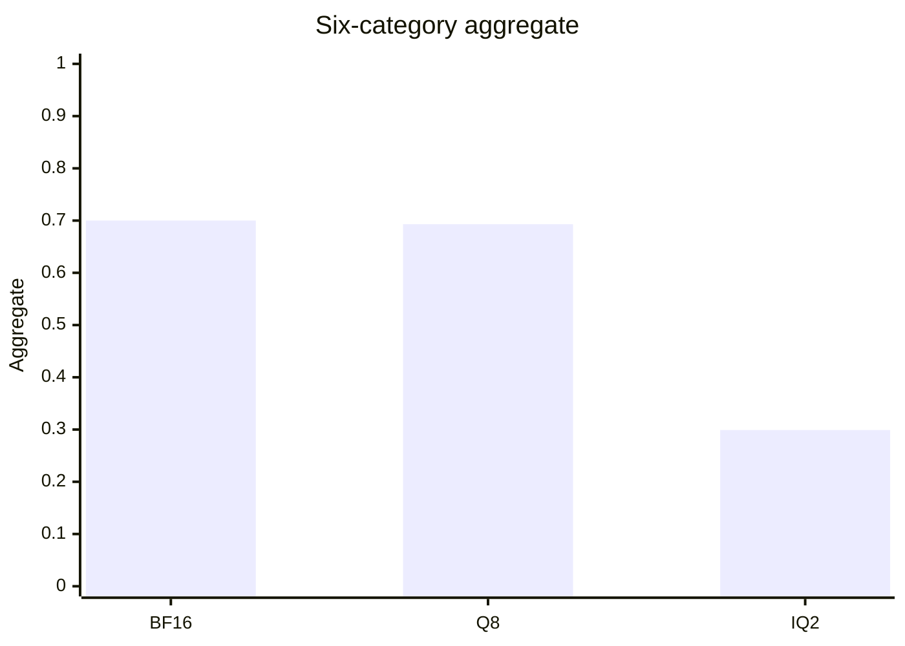

# Q4 tail and the 2B IQ2 repetition

Date: 2026-10-23. No llama-server process was started for this note.
PR #15 (`feature/p9-quality-audit`) already recorded the stored-row audit,
the partial Q4 suite, and the LONGTASK checker. This note does not rerun
those 370 Q4 rows or the closed BF16, Q8, and IQ2 suites.

Protocol `p9-2026-10-02-1` is unchanged. Locked floors stay aggregate
0.90 of the reference, reasoning and coding 0.85, every other category
0.75.

## 1. Q4 table, with the tail unfinished

Six-category aggregate is the unweighted mean of the six accuracies.
Q4 does not have one. Q5 and Q3 were not run.

| Arm | Aggregate | Reasoning | Math | Coding | Factual | Instruction | Long context | File bytes |
|---|---:|---:|---:|---:|---:|---:|---:|---:|
| BF16 | 0.700 | 29/60 | 81/100 | 13/40 | 72/100 | 43/50 | 45/45 | 3,775,709,216 |
| Q8_0 GPU | 0.693 | 30/60 | 78/100 | 14/40 | 69/100 | 42/50 | 45/45 | 2,012,012,800 |
| Q4_K_M |  | 29/60 | 71/100 | 12/40 | 67/100 | 41/50 | 20/45 | 1,280,835,840 |
| UD-IQ2_XXS | 0.299 | 8/60 | 6/100 | 1/40 | 42/100 | 10/50 | 43/45 | 768,270,592 |

Suite peak VRAM, a separate TTFT, and a speed protocol are not in these
rows. File size is the only size column filled from the rows.

Finished aggregates, and no Q4 point:

The stored Q4 long-context file has `needle:2048:0`–`14` and
`needle:4096:0`–`4`, all correct. The missing 25 ids are
`needle:4096:5`–`14` and `needle:8192:0`–`14`. Prompt SHA-256 and gold
match BF16 on all 370 shared ids.

Paired Wald 95% intervals on Q4 minus BF16, same ids:

| Category | Q4 | BF16 | Difference | 95% interval |
|---|---:|---:|---:|---|
| Reasoning | 29/60 | 29/60 | 0.000 | crosses zero |
| Math | 71/100 | 81/100 | −0.100 | entirely below zero |
| Coding | 12/40 | 13/40 | −0.025 | crosses zero |
| Factual | 67/100 | 72/100 | −0.050 | crosses zero |
| Instruction | 41/50 | 43/50 | −0.040 | crosses zero |
| Long context | 20 of 45 | 20 of 20 on the shared ids |  | 25 ids absent |

Math is the only closed category whose interval lies entirely below zero.
Seven of the 29 Q4 math misses hit the 768 cap. The other 22 finished.
None of the Q4, Q8, or BF16 wrong math answers repeat a 12-word window
four times. That is a different miss from the IQ2 loop.

Given the five finished Q4 scores, the locked point-estimate aggregate
needs at least 36/45 long-context answers correct (`minimum_long_correct`).
Twenty are already correct, so at least 16 of the remaining 25 have to
be correct before that point estimate can pass. The paired interval
cannot be computed until those rows exist. A point estimate on the ratio
is not a paired-interval call.

`benchmark/plan_p9_next.py` prints the resume command and refuses
`--launch`. The existing runner already skips ids marked `measured` and
appends one row at a time, so a stopped tail can be continued. It must
be pointed at the same two Q4 files. A new output file would rerun the
370 finished ids.

## 2. Why the stored IQ2 answers repeat

Short suite: 283 wrong of 350. Two needle misses bring the earlier
count of 285. Of the 283, 230 reached the locked cap. Math is 94 wrong,
84 of those at `predicted_n` 768, and 10 finished on a wrong number.

A 12-word window repeated at least four times appears in 80 of the 94
wrong math answers, and in 0 wrong math answers on BF16, Q8, and Q4.
Those 80 windows are 80 different phrases. The loop is about the item
in front of the model. It is not one stuck string shared by the file.

| Shape | Wrong math rows | What the window is |
|---|---:|---|
| Repeated phrase | 69 | A sentence from that problem, repeated |
| Short cycle | 11 | At most three distinct words, often one number |
| No 12-word loop | 14 | Includes the 10 answers that finished before 768 |

`gsm8k:807` is the sentence shape. The repeated line is "The number of
inches that can be made with two bags of glass chips is 144." Gold is 4.
The text has no `####`. The cap cuts the next heading at "Step 1", so
`gsm8k_predicted` reads 1. That extraction is a consequence of the cut.
The row would still be wrong if the scorer had read 144. BF16, Q8, and
Q4 answer this id correctly and do not repeat a line. The first 12 words
of the IQ2 math answer match BF16 on 1 of 100 ids, so this is not the
BF16 trace collapsing at the end.

The same launch fields are stored on every arm: temperature 0, seed 42,
system prompt null, chat mode on the 310 non-coding rows, completion
mode on the 40 coding rows. Prompt SHA-256 and gold mismatches versus
BF16 are 0 on every shared id. Coding requests pass
`CODING_STOP`. Math chat requests do not pass a stop list. Both facts
come from `benchmark/run_p9_quality.py`, and the runner uses them for
every arm. `--reasoning off` is in that server command and is not stored
in the row.

Header read of the four local GGUF files, metadata only:

| Check | BF16 | Q8 | Q4 | IQ2 |
|---|---|---|---|---|
| Name | Qwen3.5-2B | Qwen3.5-2B | Qwen3.5-2B | Qwen3.5-2B |
| Architecture / blocks / tensors | qwen35 / 24 / 320 | same | same | same |
| `file_type` | 32 | 7 | 15 | 19 |
| Token-list SHA-256 prefix | `49930cc8a75188cf` | same | same | same |
| Chat-template SHA-256 prefix | `7f0e529032c25183` | same | same | same |
| Imatrix file | none | `imatrix_unsloth.gguf`, 186 entries | same | same |

IQ2 tensor types: f32 133, iq2_xxs 95, q8_0 36, iq3_xxs 24, q4_K 18,
iq3_s 5, iq2_s 5, q2_K 3, q5_K 1. `file_type` 19 is the IQ2_XXS marker.
The header does not contain the BF16 file hash, so it does not prove
these IQ2 tensors were quantized from the BF16 file on disk. It does
rule out a different tokenizer or a different chat template.

Evidence, and what it does not reach:

| Claim | Level |
|---|---|
| Prompt text, gold, temperature, seed, and mode match across the four arms | Measured in the JSONL |
| Tokenizer and chat template match | Measured in the four headers |
| Math has no stop list, and reasoning-off is the runner default | Source. The row does not store the process flags |
| The 12-word loop is absent on BF16, Q8, and Q4 math and present on 80 IQ2 math rows | Measured in the saved text |
| The loop is caused by one named tensor | Not shown |
| A second run repeats the same cycle | Not run |

The remaining difference in the stored comparison is the weight file.
That associates the loop with this IQ2 artifact under the shared
protocol. It does not name the mechanism. Alternatives that the rows
do not close: a server flag that was not written down, and a graph
split that was not written down. Both would have to have differed for
IQ2 only. The runner source does not do that.

## 3. Minimal experiment, not started

Frozen before any change. Probe, the failure shapes:
`gsm8k:807` (repeated sentence), `gsm8k:548` (the number 67),
`gsm8k:450` (a short "Final answer" cycle), `gsm8k:48` (finished on a
wrong number at 134 tokens).

Control, IQ2 already correct and, for the three reasoning ids, not cut
by the cap: `gsm8k:52`, `gsm8k:400`, `gsm8k:848`, `gsm8k:849`,
`gsm8k:923`, `gsm8k:1085`, `logical_deduction_three_objects:71`,
`:212`, `:213`.

First rerun: IQ2 only, the same runner flags, a new file
`experiments/results/p9_iq2_probe.jsonl`. The scored IQ2 file cannot be
reused, because those ids are already marked measured and the runner
would skip them. No sampling change, no prompt change, no second quant.
If the same shapes return, the cycle is stable. The BF16, Q8, and Q4
arms of those ids are the stored controls. A fresh copy of those three
arms is a later single-factor run, one file at a time.

`probe_plan()` returns `launch: false`.

## 4. What was not changed

No sampler, prompt, or quant was edited. No CUDA kernel. The IQ2 file
remains the baseline. A repeat penalty can be a later single factor on
the probe and the control together. It is not a result. Raising the
768 cap would extend the loops that already fill it. That is not a fix.

On this 2B ladder the stored way to leave the loop is Q4_K_M. It uses
a larger file than IQ2, 1,280,835,840 bytes against 768,270,592, and it
still has the math loss in the table above. Nothing measured here keeps
the IQ2 weights and removes the loop.

## 5. LONGTASK-V1

The checker is correct against its own text: 18 ledger checks, 18
document keys, 16 route keys. See [LONGTASK_V1.md](LONGTASK_V1.md).
The deposit sentence after 2026-10-30 is unscored. The pilot plan covers
BF16, Q8, and Q4 at natural length after the Q4 tail, and it is not a
benchmark. It was not run.

## 6. Waiting on permission

Resource sample while writing this note, no model loaded: available RAM
4283 MiB, commit headroom 13583 MiB, VRAM 1330 MiB used and 6567 MiB
free of 8151, GPU utilization 1%. No `llama-server` process. Available
RAM is above the benchmark floor of 2048 MiB in
[SYSTEM_RESOURCE_SAFETY.md](SYSTEM_RESOURCE_SAFETY.md). That sample is
not permission to start.

1. Resume the 25 Q4 needles with the command from `plan_p9_next.py`.
2. After that aggregate exists, decide Q3 or Q5 from the locked ratios.
3. Rerun the four IQ2 probe ids into a new JSONL, same flags.
4. Natural-length LONGTASK pilot on BF16, Q8, and Q4.

## 7. Next hypothesis

The 2B UD-IQ2_XXS file, under the shared protocol, decodes into an
item-specific cycle often enough to hit the cap. A same-flag rerun of
the four probe ids is the check. If the cycle returns on IQ2 only, the
association with that file is replicated. Which tensor does it is still
open, and it is not answered by transferring the 2B rate onto 27B.
