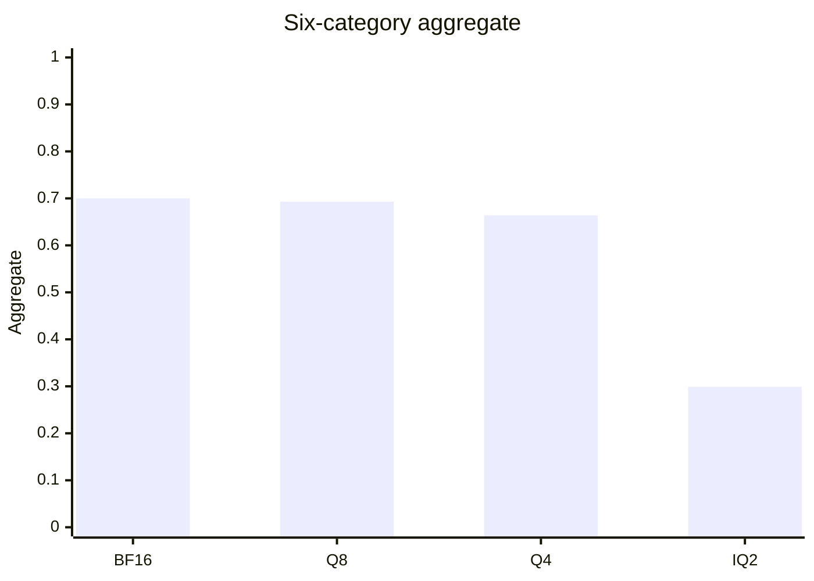

# Q4 tail and the 2B IQ2 repetition

The Q4 long-context tail finished on 2026-10-24 at 45/45. The 350 short
rows were not rerun. Protocol `p9-2026-10-02-1` and the locked floors
are unchanged: aggregate 0.90 of the reference, reasoning and coding
0.85, every other category 0.75.

The resume process used `--override-tensor token_embd.weight=CUDA0`.
Its log says `offloaded 25/25`, CUDA0 buffer 1211.05 MiB, and
`graph splits = 1`. The summary row records that extra. The earlier 350
short rows and the first 20 needles do not record it. All 25 new needles
are correct, and the earlier 20 were already correct. Prompt SHA-256 and
gold match BF16 on all 395 ids.

During that run, available RAM was 4217 MiB, VRAM used was 2402 MiB of
8151, and GPU utilization was 92%. Afterwards the server was gone,
available RAM was 5111 MiB, and VRAM used was 1069 MiB.

## 1. Closed Q4 comparison

Six-category aggregate is the unweighted mean of the six accuracies.
Q5 and Q3 were not run.

| Arm | Aggregate | Reasoning | Math | Coding | Factual | Instruction | Long context | File bytes |
|---|---:|---:|---:|---:|---:|---:|---:|---:|
| BF16 | 0.700 | 29/60 | 81/100 | 13/40 | 72/100 | 43/50 | 45/45 | 3,775,709,216 |
| Q8_0 GPU | 0.693 | 30/60 | 78/100 | 14/40 | 69/100 | 42/50 | 45/45 | 2,012,012,800 |
| Q4_K_M | 0.664 | 29/60 | 71/100 | 12/40 | 67/100 | 41/50 | 45/45 | 1,280,835,840 |
| UD-IQ2_XXS | 0.299 | 8/60 | 6/100 | 1/40 | 42/100 | 10/50 | 43/45 | 768,270,592 |

Q4 aggregate is 0.663889, which is 0.949 of BF16 0.699722. The point
estimate `quality_verdict` is `PASS`. The paired study call is
`INCONCLUSIVE` because the reasoning and coding intervals cross their
locked margins. Suite peak VRAM is not in the rows. The load log's CUDA
buffer is 1211.05 MiB.

Paired Wald 95% on Q4 minus BF16. The margin is the locked ratio applied
to the BF16 accuracy. The aggregate interval is a 10,000-draw paired
bootstrap, seed 42, the same draw that reproduces the stored Q8
aggregate low.

| Category | Q4 | BF16 | Delta | 95% interval | Margin | Call |
|---|---:|---:|---:|---|---:|---|
| Reasoning | 29/60 | 29/60 | 0.000 | −0.092 to +0.092 | −0.073 | STRADDLES_MARGIN |
| Math | 71/100 | 81/100 | −0.100 | −0.176 to −0.024 | −0.203 | INSIDE_MARGIN |
| Coding | 12/40 | 13/40 | −0.025 | −0.110 to +0.060 | −0.049 | STRADDLES_MARGIN |
| Factual | 67/100 | 72/100 | −0.050 | −0.108 to +0.008 | −0.180 | INSIDE_MARGIN |
| Instruction | 41/50 | 43/50 | −0.040 | −0.150 to +0.070 | −0.215 | INSIDE_MARGIN |
| Long context | 45/45 | 45/45 | 0.000 | 0 to 0 | −0.250 | INSIDE_MARGIN |
| Aggregate | 0.664 | 0.700 | −0.036 | −0.068 to −0.004 | −0.070 | INSIDE_MARGIN |

Math is a real loss: the interval lies entirely below zero, and it is
still inside the 0.75 floor. Seven of the 29 Q4 math misses hit the 768
cap. None of those wrong answers repeat a 12-word window four times.

Needle medians from the Q4 rows. `prompt_ms` is prompt time. A separate
TTFT was not stored. This is not a speed protocol.

| Filled context | Correct | Median prompt | Median decode |
|---|---:|---:|---:|
| 2048 | 15/15 | 7.68 s | 162.44 tok/s |
| 4096 | 15/15 | 15.47 s | 159.99 tok/s |
| 8192 | 15/15 | 31.56 s | 154.55 tok/s |

The pre-registered rule sends the next format to Q3_K_M. The point
estimate passes, and the aggregate interval stays inside 0.90 of BF16.
It does not send the next format to Q5. The bootstrap low, −0.068, sits
just above the −0.070 floor. Q3 was not loaded.

## 2. Why the stored IQ2 answers repeat

Short suite: 283 wrong of 350. Two needle misses bring the earlier
count of 285. Of the 283, 230 reached the locked cap. Math is 94 wrong,
84 of those at `predicted_n` 768, and 10 finished on a wrong number.

A 12-word window repeated at least four times appears in 80 of the 94
wrong math answers, and in 0 wrong math answers on BF16, Q8, and Q4.
Those 80 windows are 80 different phrases. The loop is about the item
in front of the model. It is not one stuck string shared by the file.

| Shape | Wrong math rows | What the window is |
|---|---:|---|
| Repeated phrase | 69 | A sentence from that problem, repeated |
| Short cycle | 11 | At most three distinct words, often one number |
| No 12-word loop | 14 | Includes the 10 answers that finished before 768 |

`gsm8k:807` is the sentence shape. The repeated line is "The number of
inches that can be made with two bags of glass chips is 144." Gold is 4.
The text has no `####`. The cap cuts the next heading at "Step 1", so
`gsm8k_predicted` reads 1. That extraction is a consequence of the cut.
The row would still be wrong if the scorer had read 144. BF16, Q8, and
Q4 answer this id correctly and do not repeat a line. The first 12 words
of the IQ2 math answer match BF16 on 1 of 100 ids, so this is not the
BF16 trace collapsing at the end.

The same launch fields are stored on every arm: temperature 0, seed 42,
system prompt null, chat mode on the 310 non-coding rows, completion
mode on the 40 coding rows. Prompt SHA-256 and gold mismatches versus
BF16 are 0 on every shared id. Coding requests pass
`CODING_STOP`. Math chat requests do not pass a stop list. Both facts
come from `benchmark/run_p9_quality.py`, and the runner uses them for
every arm. `--reasoning off` is in that server command and is not stored
in the row.

Header read of the four local GGUF files, metadata only:

| Check | BF16 | Q8 | Q4 | IQ2 |
|---|---|---|---|---|
| Name | Qwen3.5-2B | Qwen3.5-2B | Qwen3.5-2B | Qwen3.5-2B |
| Architecture / blocks / tensors | qwen35 / 24 / 320 | same | same | same |
| `file_type` | 32 | 7 | 15 | 19 |
| Token-list SHA-256 prefix | `49930cc8a75188cf` | same | same | same |
| Chat-template SHA-256 prefix | `7f0e529032c25183` | same | same | same |
| Imatrix file | none | `imatrix_unsloth.gguf`, 186 entries | same | same |

IQ2 tensor types: f32 133, iq2_xxs 95, q8_0 36, iq3_xxs 24, q4_K 18,
iq3_s 5, iq2_s 5, q2_K 3, q5_K 1. `file_type` 19 is the IQ2_XXS marker.
The header does not contain the BF16 file hash, so it does not prove
these IQ2 tensors were quantized from the BF16 file on disk. It does
rule out a different tokenizer or a different chat template.

Evidence, and what it does not reach:

| Claim | Level |
|---|---|
| Prompt text, gold, temperature, seed, and mode match across the four arms | Measured in the JSONL |
| Tokenizer and chat template match | Measured in the four headers |
| Math has no stop list, and reasoning-off is the runner default | Source. The row does not store the process flags |
| The 12-word loop is absent on BF16, Q8, and Q4 math and present on 80 IQ2 math rows | Measured in the saved text |
| The loop is caused by one named tensor | Not shown |
| A second run repeats the same cycle | Not run |

The remaining difference in the stored comparison is the weight file.
That associates the loop with this IQ2 artifact under the shared
protocol. It does not name the mechanism. Alternatives that the rows
do not close: a server flag that was not written down, and a graph
split that was not written down. Both would have to have differed for
IQ2 only. The runner source does not do that.

## 3. Minimal experiment, not started

Frozen before any change. Probe, the failure shapes:
`gsm8k:807` (repeated sentence), `gsm8k:548` (the number 67),
`gsm8k:450` (a short "Final answer" cycle), `gsm8k:48` (finished on a
wrong number at 134 tokens).

Control, IQ2 already correct and, for the three reasoning ids, not cut
by the cap: `gsm8k:52`, `gsm8k:400`, `gsm8k:848`, `gsm8k:849`,
`gsm8k:923`, `gsm8k:1085`, `logical_deduction_three_objects:71`,
`:212`, `:213`.

First rerun: IQ2 only, the same runner flags, a new file
`experiments/results/p9_iq2_probe.jsonl`. The scored IQ2 file cannot be
reused, because those ids are already marked measured and the runner
would skip them. No sampling change, no prompt change, no second quant.
If the same shapes return, the cycle is stable. The BF16, Q8, and Q4
arms of those ids are the stored controls. A fresh copy of those three
arms is a later single-factor run, one file at a time.

`probe_plan()` returns `launch: false`.

## 4. What was not changed

No sampler, prompt, or quant was edited. No CUDA kernel. The IQ2 file
remains the baseline. A repeat penalty can be a later single factor on
the probe and the control together. It is not a result. Raising the
768 cap would extend the loops that already fill it. That is not a fix.

On this 2B ladder the stored way to leave the loop is Q4_K_M. It uses
a larger file than IQ2, 1,280,835,840 bytes against 768,270,592, and it
still has the math loss in the table above. Nothing measured here keeps
the IQ2 weights and removes the loop.

## 5. LONGTASK-V1

The checker is correct against its own text: 18 ledger checks, 18
document keys, 16 route keys. See [LONGTASK_V1.md](LONGTASK_V1.md).
The deposit sentence after 2026-10-30 is unscored. The pilot plan covers
BF16, Q8, and Q4 at natural length after the Q4 tail, and it is not a
benchmark. It was not run.

## 6. What is still open

Q3_K_M is the next format under the locked rule. It was not downloaded
and not loaded. The four-id IQ2 reproduction and the natural-length
LONGTASK pilot on BF16, Q8, and Q4 have not been run.

## 7. Next hypothesis

The 2B UD-IQ2_XXS file, under the shared protocol, decodes into an
item-specific cycle often enough to hit the cap. A same-flag rerun of
`gsm8k:807`, `gsm8k:548`, `gsm8k:450`, and `gsm8k:48` is the check. If
the cycle returns, the association with that file is replicated. Which
tensor does it is still open, and the 2B rate is not a 27B rate. Q4 on
this same protocol does not show that cycle, and its six-category point
estimate stays inside the locked floors.
